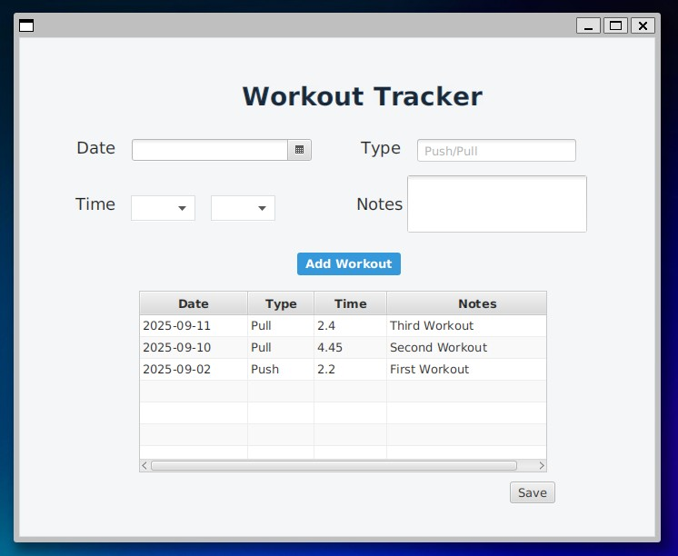
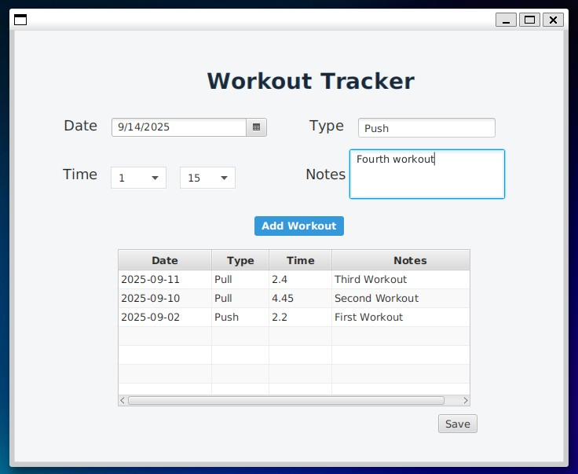
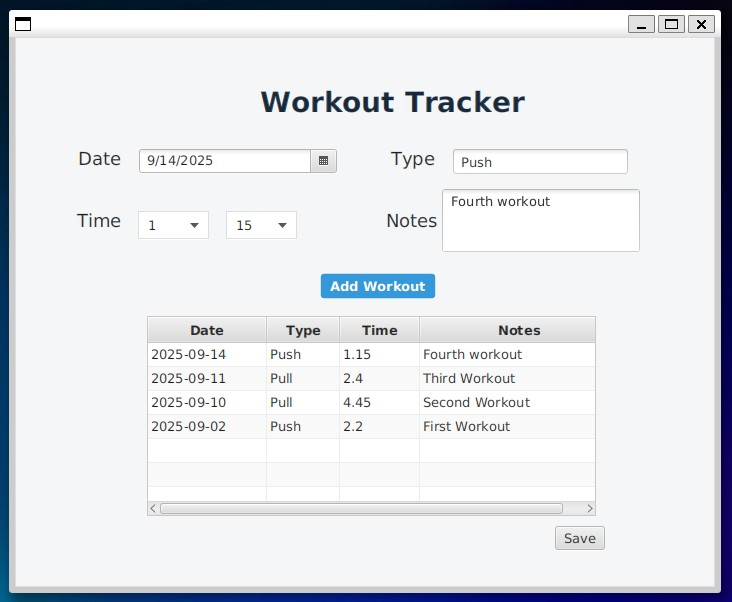
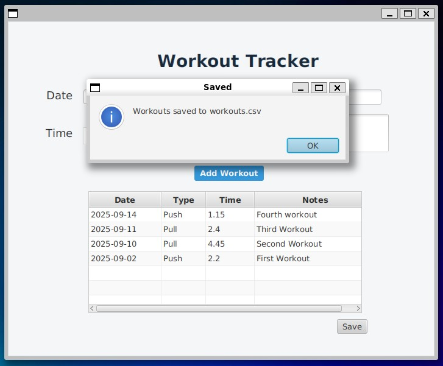

# Release 1 - Workout Tracker

## Overview
Release 1 delivers a fully functional workout tracking application with a JavaFX-based user interface. Users can create, view, and persist workout data through an intuitive desktop application.

## Implemented Features

### Core Functionality
- **Workout Creation**: Add new workouts with type, date, duration, and notes
- **Workout Display**: View all workouts in a sortable table format
- **Data Persistence**: Save and load workouts to/from CSV files
- **Input Validation**: Comprehensive validation for all user inputs
- **Error Handling**: User-friendly error messages and alerts

### User Interface
- **Clean Design**: Modern, professional interface with consistent styling
- **Form Input**: Date picker, time selection (hours/minutes), text fields for type and notes
- **Data Table**: Sortable columns showing date, type, duration, and notes
- **Responsive Layout**: Proper spacing and alignment for optimal user experience

### Technical Implementation
- **MVC Architecture**: Separation of concerns with UI controller, business logic, and data persistence
- **JavaFX Integration**: Full JavaFX application with FXML-based UI
- **CSV File Management**: Robust file I/O with error handling
- **Observable Collections**: Real-time UI updates when data changes

## User Stories - Completed

### ✅ User Story 1: Add Workouts
**As a user, I want to add a workout to track my progress.**

**Implementation:**
- Form with fields for workout type, date, time duration, and notes
- Time selection via combo boxes (0-10 hours, 0-55 minutes in 5-minute increments)
- Input validation ensures all required fields are completed
- New workouts appear immediately in the table (most recent first)

### ✅ User Story 2: View Workout History
**As a user, I want to be able to see previously completed workouts so I can monitor my own progress.**

**Implementation:**
- Table view displaying all workouts with columns for date, type, duration, and notes
- Automatic loading of saved workouts on application startup
- Chronological display with newest workouts at the top

## Technical Architecture

### Core Classes
- **`Workout`**: Data model representing a single workout session
- **`WorkoutTracker`**: Business logic for managing workout collections
- **`WorkoutFileManager`**: Handles CSV file persistence operations
- **`AppController`**: JavaFX controller managing UI interactions

### Data Model
```java
Workout {
    - type: String (e.g., "Push", "Pull", "Running")
    - notes: String (minimum 3 characters)
    - date: LocalDate
    - time: double (duration in hours)
}
```

### File Format
Workouts are stored in CSV format with semicolon delimiters:
```
Type;Notes;Date;Time
Push;Fourth workout;2025-09-14;1.15
Pull;Third Workout;2025-09-11;2.4
```

## Validation Rules
- **Type**: Cannot be null or empty
- **Notes**: Must be at least 3 characters long
- **Date**: Cannot be null (defaults to current date)
- **Time**: Must be greater than 0 (both hours and minutes must be selected)

## Error Handling
- Input validation with user-friendly error dialogs
- File I/O error handling with informative messages
- Graceful handling of missing or corrupted data files
- Automatic file creation if data directory doesn't exist

## Testing
- Unit tests for core business logic (`WorkoutTrackerTest`)
- UI tests for user interactions (`AppTest`)
- File persistence testing with various data scenarios

## Screenshots / Mockups





## Future Enhancements (Release 2+)
- Workout editing and deletion capabilities
- Data filtering and search functionality
- Progress tracking and statistics
- Export to different file formats
- Workout categories and tags
