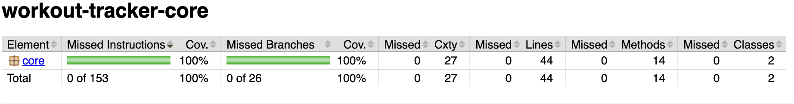
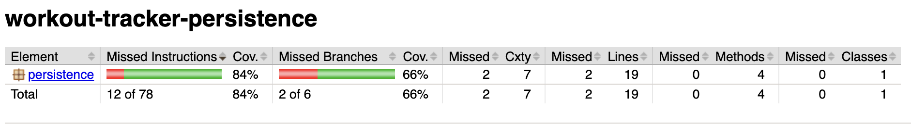
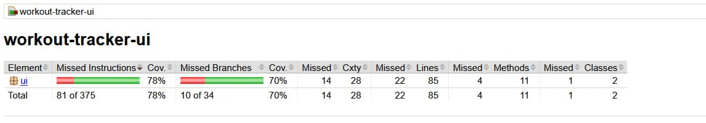

# Code Quality – Release 2 (Java/Maven)

> Location: `gr2528/docs/release2/code-quality.md`

This file documents the **chosen tools**, their **configurations**, and **how they are applied** in the `workout-tracker` multi-module Maven project.

---

## Tools & Configurations

### 1) SpotBugs (static analysis)

**Plugin:** `com.github.spotbugs:spotbugs-maven-plugin:4.9.6.0`

**Configuration (parent POM):**

```xml
<plugin>
  <groupId>com.github.spotbugs</groupId>
  <artifactId>spotbugs-maven-plugin</artifactId>
  <version>4.9.6.0</version>
  <configuration>
    <xmlOutput>false</xmlOutput>
    <htmlOutput>true</htmlOutput>
    <excludeFilterFile>../config/spotbugs/exclude.xml</excludeFilterFile>
  </configuration>
  <executions>
    <execution>
      <id>spotbugs-check</id>
      <phase>verify</phase>
      <goals><goal>check</goal></goals>
    </execution>
  </executions>
</plugin>
```

**Applied:** Runs during **`verify`** for each module (`core`, `ui`, `persistence`). The exclude file is resolved relative to each module directory (`../config/spotbugs/exclude.xml`). Fails the build on detected issues.

---

### 2) JaCoCo (test coverage)

**Plugin:** `org.jacoco:jacoco-maven-plugin:0.8.13`

**Configuration (parent POM):**

```xml
<plugin>
  <groupId>org.jacoco</groupId>
  <artifactId>jacoco-maven-plugin</artifactId>
  <version>0.8.13</version>
  <executions>
    <execution>
      <id>prepare-agent</id>
      <goals><goal>prepare-agent</goal></goals>
    </execution>
    <execution>
      <id>report</id>
      <phase>test</phase>
      <goals><goal>report</goal></goals>
    </execution>
  </executions>
</plugin>
```

**Applied:** The agent is attached to tests; coverage **reports are generated** per module under `target/site/jacoco/`. **No coverage gate is configured** (the build does not fail on low coverage).

Example jacoco report: , , 

---

### 3) Maven Surefire (test execution)

**Plugin:** `org.apache.maven.plugins:maven-surefire-plugin:${maven.surefire.plugin.version}` where `${maven.surefire.plugin.version}` = **3.1.2**.

**Configuration (parent POM):**

```xml
<plugin>
  <groupId>org.apache.maven.plugins</groupId>
  <artifactId>maven-surefire-plugin</artifactId>
  <version>${maven.surefire.plugin.version}</version>
  <configuration>
    <argLine>${argLine}</argLine>
  </configuration>
</plugin>
```

**Applied:** Runs unit tests during the **`test`** phase with JUnit 5 support. `${argLine}` is populated by JaCoCo so coverage is collected.

---

### 4) Testing libraries

* **JUnit 5 (Jupiter)**: `${junit.version}` = **5.10.0** (`junit-jupiter-api`, `junit-jupiter-engine`, `junit-jupiter-params`, scope `test`).
* **TestFX**: `${testfx.version}` = **4.0.16-alpha** (`testfx-core`, `testfx-junit5`, scope `test`).
* **Hamcrest**: `${hamcrest.version}` = **2.2** (`hamcrest`, scope `test`).

**Applied:** These are declared under **`dependencyManagement`** in the parent POM. Modules use them (with `test` scope) for unit/UI testing executed by Surefire.

> Note: JavaFX **(17.0.1)** is a runtime/UI dependency, not a code-quality tool; included here only as context for TestFX-based UI tests.

---

### 5) Checkstyle (formatting & style)

**Plugin:** `org.apache.maven.plugins:maven-checkstyle-plugin:3.3.1`

**Configuration (parent POM):**

```xml
<!-- CHECKSTYLE -->
<plugin>
  <groupId>org.apache.maven.plugins</groupId>
  <artifactId>maven-checkstyle-plugin</artifactId>
  <version>3.3.1</version>
  <configuration>
    <!-- Points to the root config regardless of module -->
    <configLocation>${session.executionRootDirectory}/config/checkstyle/checkstyle.xml</configLocation>
    <consoleOutput>true</consoleOutput>
    <failsOnError>true</failsOnError>  <!-- Fails build on violation -->
    <excludes>**/module-info.java</excludes>
  </configuration>
  <executions>
    <execution>
      <id>checkstyle-verify</id>
      <phase>verify</phase>     <!-- Runs alongside other quality tools -->
      <goals>
        <goal>check</goal>
      </goals>
    </execution>
  </executions>
</plugin>
```

**Applied:** Runs during **`verify`** for each module. Uses a shared ruleset at `config/checkstyle/checkstyle.xml`. **Fails the build** on any reported violation. `module-info.java` files are excluded.

---
