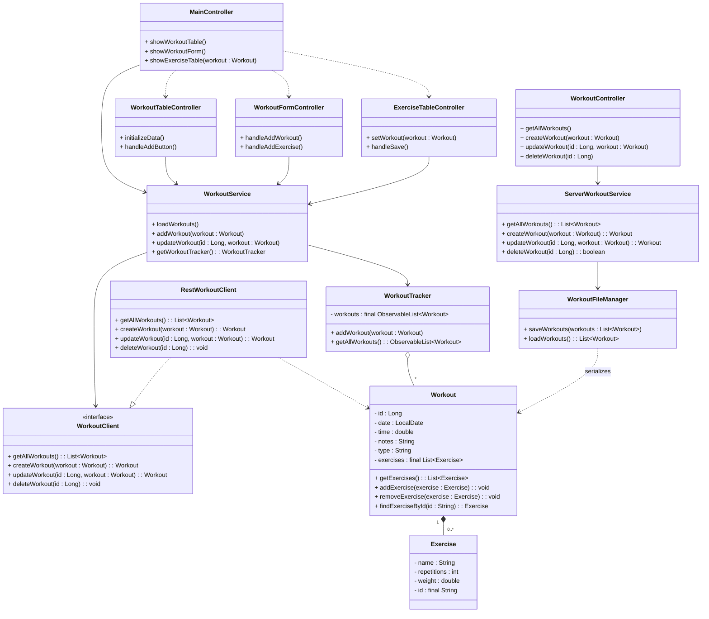

<!-- How to view -->
<!--
Viewing options:
1) GitHub renders Mermaid automatically when viewing this file in the repo UI.
2) VS Code with the "Markdown Preview Mermaid Support" extension will render it in the Markdown preview.
3) Use Mermaid Live Editor: copy the code block below into https://mermaid.live and view/export. You will have to remove the first line "``` mermaid" to view it.
-->

