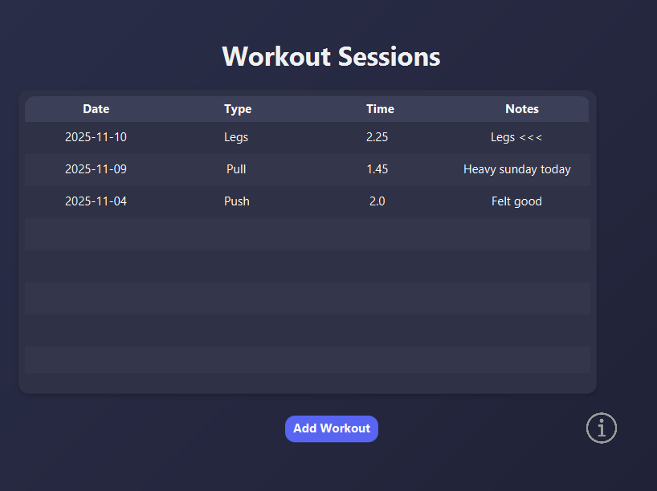
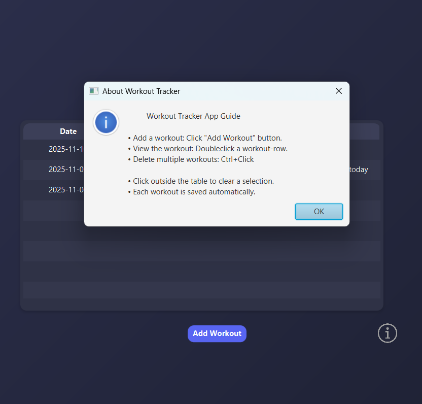
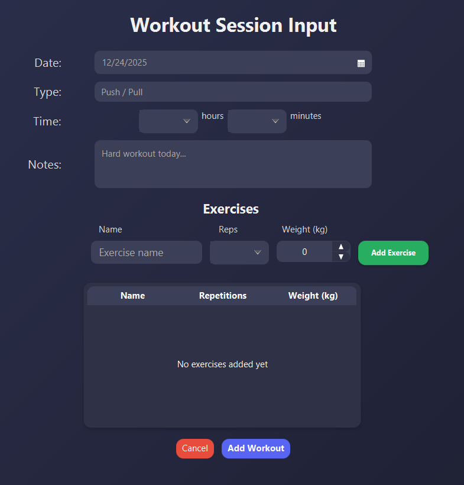
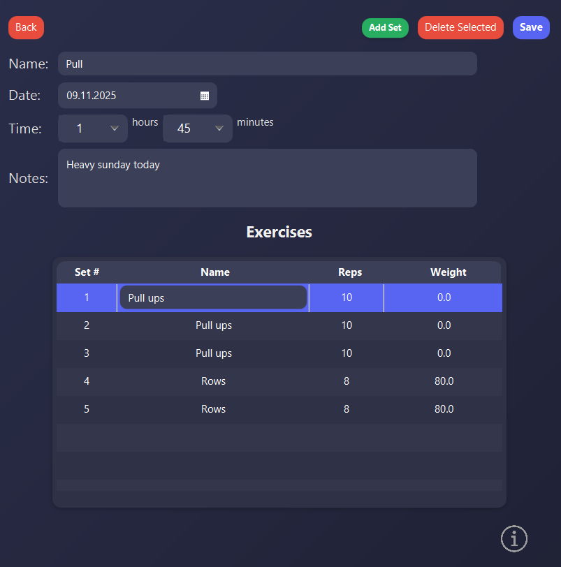
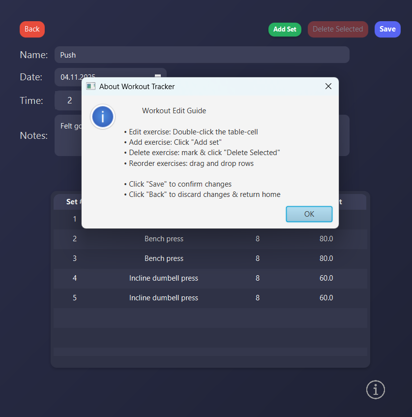

# Release 3

## Overview

Release 3 establishes the required separation between backend and client components. The application is now organized as a Spring Boot server that exposes the workout API and a JavaFX client that consumes it. Beyond the architectural restructuring, this release adds per-exercise data in the domain model, improves the editing workflow in the client, and updates documentation to reflect the new scope and quality requirements.

## Implemented Features

### Architectural Separation
- **Spring Boot REST server**: New `workout-tracker/server` module packages the core domain and persistence layers behind `/api/workouts` endpoints.
- **Shared domain model**: `core` remains the single source of truth for entities and validation, reducing duplication between client and server.
- **File-backed persistence**: The server reuses `WorkoutFileManager` to persist data to `data/workouts.json`, keeping compatibility with earlier releases.

### REST API & Integration
- **Full CRUD endpoints**: `GET`, `POST`, `PUT`, and `DELETE` operations provide complete lifecycle management for workouts (see `rest-api.md` for payloads).
- **ID management**: The server assigns stable numeric IDs while the JavaFX client caches them locally via `WorkoutService`.
- **Error handling & CORS**: Uniform JSON error responses and open CORS configuration allow future clients (web/mobile) to integrate without extra setup.

### JavaFX Client Enhancements
- **REST-backed UI**: `MainController` boots the app by loading workouts from the server and surfaces connection failures with user-facing alerts.
- **Exercise editor view**: New `ExerciseTableView` lets users manage sets for a workout with inline editing, drag-and-drop reordering, staged edits, and undo via “Back”.
- **Form refinements**: Duration pickers now separate hours/minutes, and header fields toggle editability to prevent accidental changes.

### Domain Model Updates
- **Exercise entity**: Introduced `core.Exercise` with validation, UUID identifiers, and Jackson annotations for seamless JSON serialization.
- **Workout validation**: `Workout` now enforces non-empty exercise lists, supports ID assignment, and exposes helper methods used by both server and client flows.
- **Service abstraction**: `core.service.WorkoutService` coordinates local state with a `WorkoutClient` interface, easing future testability and alternative client implementations.

## Quality Assurance
- **Automated tests**: Expanded unit tests (e.g., `WorkoutServiceTest`) verify REST integration logic with mock clients alongside existing core tests.
- **Static analysis & coverage**: Checkstyle, SpotBugs, and JaCoCo remain wired for every module; running `mvn verify` at the project root executes style checks, tests, and coverage reports.
- **Che-ready tooling**: Updated instructions in the root `README.md` ensure evaluators can open the repo in Eclipse Che and run the split server/client workflow.

## Documentation Updates
- **Architecture diagrams**: Updated UML artifacts (`class-diagram-release3.md`, `package-diagram/package-diagram.puml/png`, `sequence-diagram.puml`) reflect the new REST layers.
- **Process reflections**: Refreshed `teamwork.md` and `ai-tools.md` capture collaboration habits and responsible AI usage for this milestone.
- **REST reference**: `rest-api.md` documents request/response formats, validation rules, and example flows for the published API.
- **Sustainability focus**: `sustainability/sustainability.md` discusses the project’s sustainability considerations for this iteration.

## Screenshots / Demo
- Add updated UI captures (e.g., main dashboard, exercise editor, REST error dialog) under `docs/release3/screenshots/` and reference them here:

- Main dashboard (and with informatiin button clicked)

    

    

- Workout creation form

    

- Workout edit form (and with information button clicked)

    
    
    

