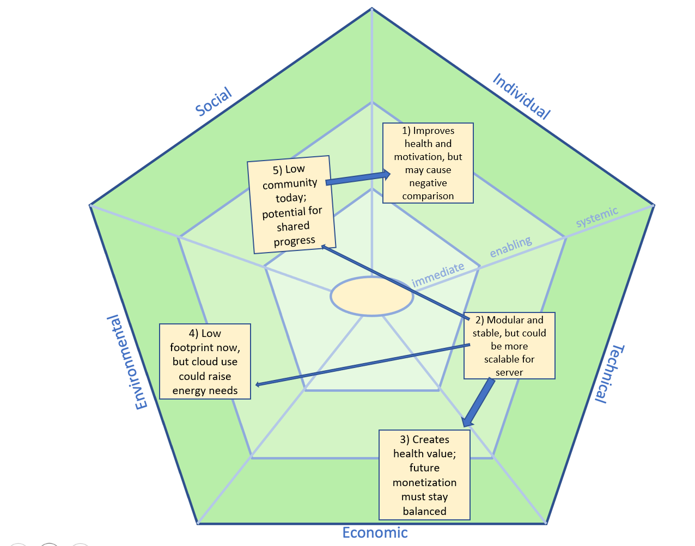

# Sustainability Reflection

This reflection evaluates the sustainability aspects of our workout tracking application using the SusAF framework. Even though the current version is small and locally hosted, it is still relevant to consider how design and technology choices can influence long-term sustainability.

### Individual Dimension
From an individual and immediate-level perspective, the system primarily affects the aspects related to health and agency.
The application can have a clear positive impact on users’ physical health by making it easier to track workouts and visualize progress over time. Tracking one’s performance can help maintain motivation, foster a sense of achievement, and encourage regular physical activity. At the same time, there are potential mental health risks, like future versions allowing multiple users or shared data. In that case, comparative dynamics could lead to body dissatisfaction or reduced self-esteem.
The app supports user agency, as the user has complete control over their workouts and how they interact with the system. The user decides what to log, edit or delete, and the system does not impose predefined goals or recommendations. This autonomy reinforces the idea that technology should empower rather than control the user. An important consideration at the enabling level, where design decisions shape long-term user behavior. From a sustainability perspective, this is valuable because it promotes reflective and intentional engagement with digital tools, rather than passive consumption or dependency on algorithmic suggestions.

### Social Dimension
In its current form, the application scores low on sense of community and participation, as it only supports one local user. However, it has the potential to promote social connection if expanded to include shared progress and fitness journeys, enhancing the system’s social sustainability.
The system performs well in terms of inclusiveness and diversity, as it does not depend on gender, age, or ethnicity. Any user can benefit equally from its features. Similarly, equity is not a critical issue, since the app treats all users identically.

### Environmental Dimension
The environmental impact of the system is relatively low. It runs on existing personal devices and therefore gives the app a small material footprint, especially since all data is stored locally rather than on large cloud servers.
The main environmental concern to consider for future scalability relates to energy consumption. There are many apps for tracking workouts. The app could be considered «just another app» for the general public, while occupying cloud servers that consume energy and pollute the environment.

### Economic Dimension
The system creates value mainly through improved health and motivation, which can indirectly reduce healthcare costs. It has little economic impact now, but could generate revenue through premium features in the future. 

### Technical Dimension
From a structural level, the system scores well in maintainability and usability, which are central to long-term sustainability. The codebase follows a modular structure with clear separation between UI, core logic, and server components. We have documented the system through comments and Javadoc, and followed common conventions such as consistent naming, dependency management with Maven, and version control practices. This makes the system easier for future developers to understand and extend.
The system relies on Java 17, JavaFX, and Spring Boot technologies that are open source, well-established, and likely to remain supported for the next decade. This ensures long-term stability and compatibility across operating systems.
However, from a system-level perspective, the local JSON-based storage is simple but not scalable. Future updates could cause data loss or compatibility issues if not properly managed. Thus, while the current design is stable, its sustainability depends on more robust data management as the system evolves.

## Conclusion
Overall, the system demonstrates good sustainability across most dimensions. It promotes healthy behavior, maintains low environmental impact, and is built on stable, maintainable technology.

## SusAD-diagram

*Social -> Individual: Social features may increase the individual motivation and mental health*  
*Technical -> Environmental: Effective code and local datastorage reduces energyconsumption.*  
*Technical -> Social: Stable and user-friendly system increases trust and therefore social participation*  
*Technical -> Economic: Technical choices (enabling) reduces maintanence costs over time (structural)